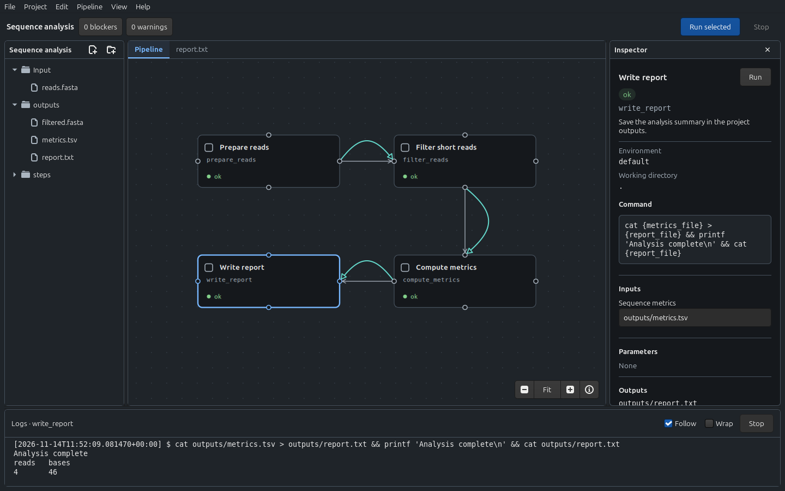
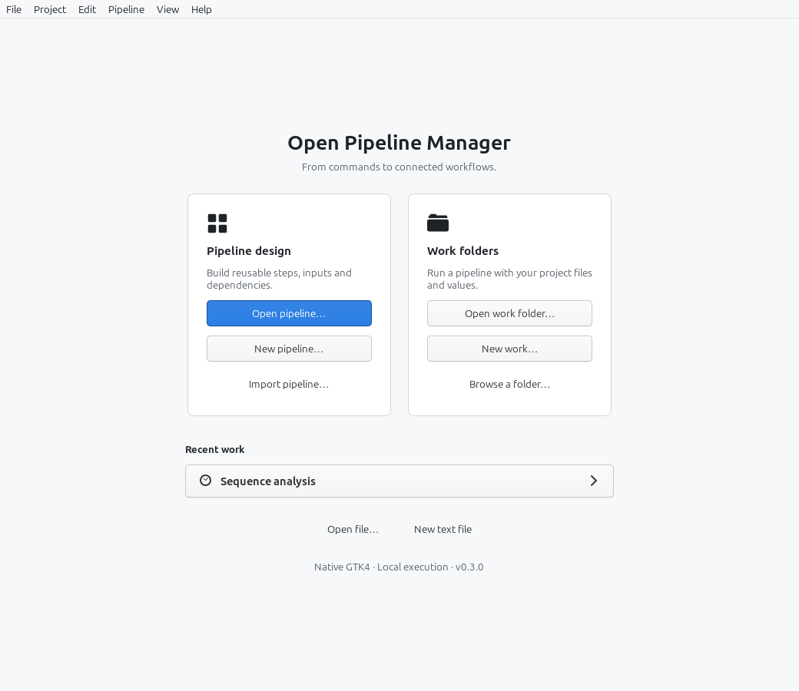
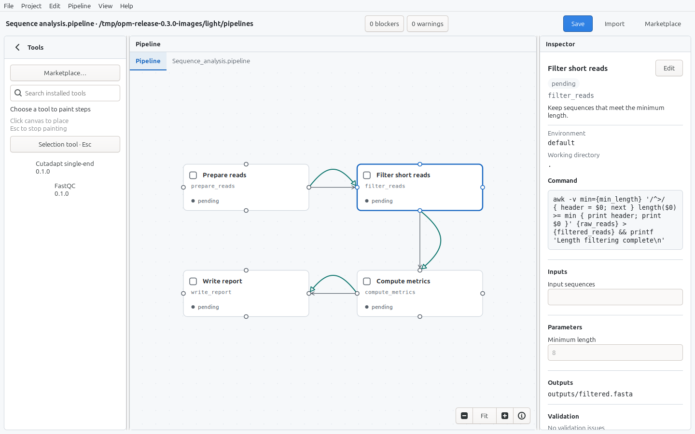
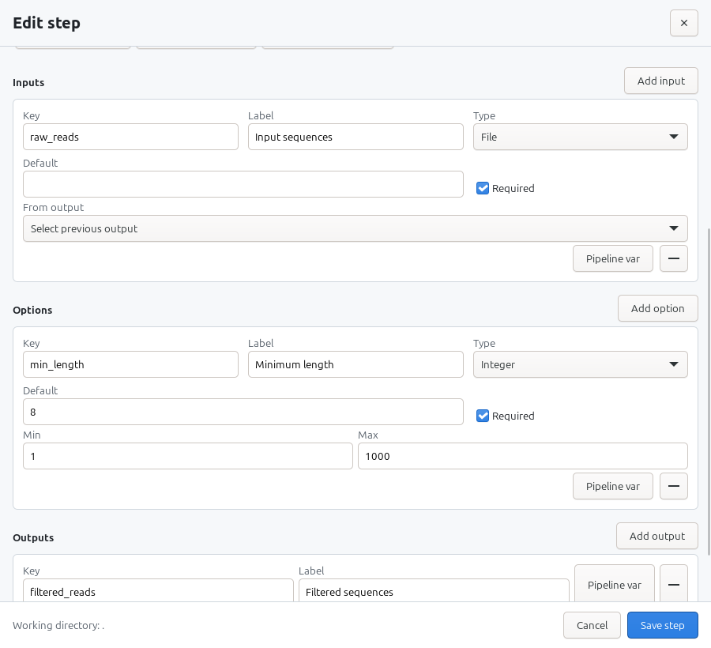
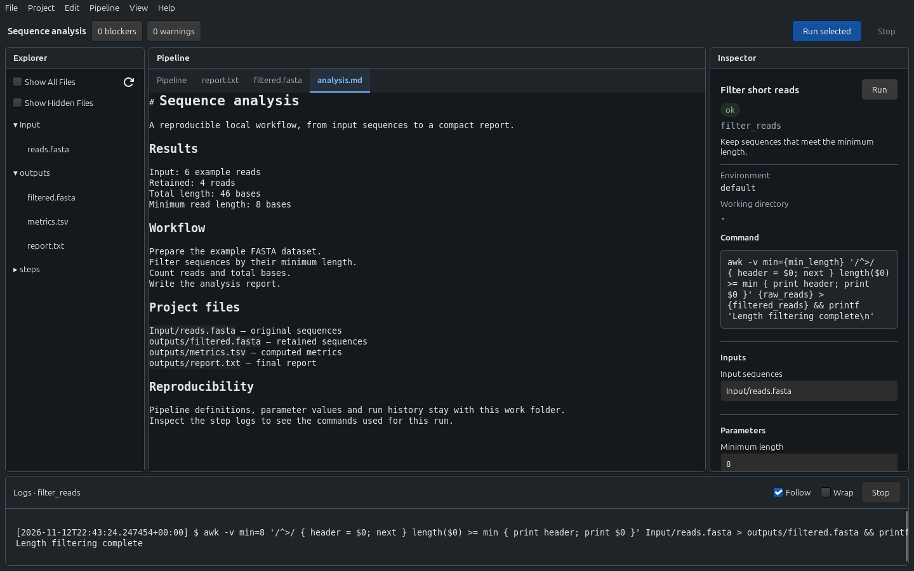
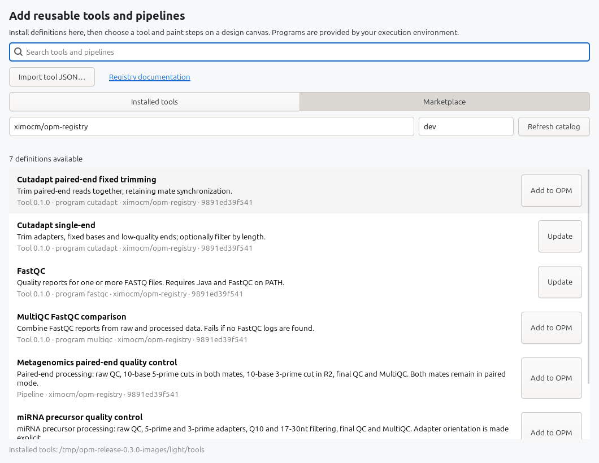

<div align="center">

# Open Pipeline Manager

**From commands to connected workflows.**

A native desktop workbench for designing, validating, and running local pipelines.

[](CHANGELOG.md)
[](BUILDING.md)
[](docs/UI_DESIGN.md)
[](https://github.com/ximocm/OpenPipelineManager/actions/workflows/ci.yml)
[](LICENSE)

**Linux · Windows · macOS**

[Downloads](https://github.com/ximocm/OpenPipelineManager/releases) · [Quick start](#quick-start) · [Manual](MANUAL.md) · [Tool registry](https://github.com/ximocm/opm-registry)

<picture>
  <source media="(prefers-color-scheme: dark)" srcset="docs/screenshots/workspace-dark.png">
  <source media="(prefers-color-scheme: light)" srcset="docs/screenshots/workspace-light.png">
  
</picture>

<sub>A complete workflow, its files, configuration, and execution history in one workspace.</sub>

</div>

---

Turn shell-based workflows into visible, reusable pipeline documents. Connect steps on a canvas, declare their inputs and outputs, check validation, then run them against a work folder on your machine.

Open Pipeline Manager is built with **Rust, GTK4, and Cairo**. The native application keeps pipeline definitions separate from execution projects, with local files, explicit saves, and per-step logs.

## One workspace, from design to results

| Design | Validate | Run & inspect |
| --- | --- | --- |
| Arrange steps vertically or horizontally. Connect any of a card's four ports and configure commands, inputs, options, and outputs. | Catch missing inputs, invalid values, broken links, dependency cycles, and unsafe project paths before execution. | Run selected or pending steps in dependency order. Follow logs, inspect outputs, and return to the saved work later. |

- **Reusable tools.** Browse the Marketplace, import tool JSON, and place configured tool instances with the canvas brush.
- **Files alongside the graph.** Explore project folders, open document tabs, edit Markdown in source or Visual Mode, and inspect YAML, JSON, shell, FASTA, and image files.
- **Native controls.** Resizable panes, light/dark themes, keyboard navigation, pan, zoom, and Fit keep the workspace usable across different layouts.
- **Explicit changes.** Dirty-document guards, upload conflict checks, native file dialogs, and validation protect the editing and execution flow.

## Start with your work

Open a reusable pipeline, create a new design, or choose a work folder to continue an analysis. The start page also offers recent work and ordinary file editing. Explicit file and folder arguments open directly.

<picture>
  <source media="(prefers-color-scheme: dark)" srcset="docs/screenshots/welcome-dark.png">
  <source media="(prefers-color-scheme: light)" srcset="docs/screenshots/welcome-light.png">
  
</picture>

## A closer look

Click a screenshot to see it at full size.

<table>
  <tr>
    <td width="50%" valign="top">
      <strong>Design connected workflows</strong><br><br>
      <a href="docs/screenshots/design-light.png"></a>
      <p>Reusable tool definitions, four connection ports, and continuous links that adapt to your layout.</p>
    </td>
    <td width="50%" valign="top">
      <strong>Configure typed inputs and options</strong><br><br>
      <a href="docs/screenshots/configure-light.png"></a>
      <p>Named inputs and outputs, required fields, defaults, ranges, selectors, and command placeholders.</p>
    </td>
  </tr>
  <tr>
    <td width="50%" valign="top">
      <strong>Keep notes and results together</strong><br><br>
      <a href="docs/screenshots/editor-dark.png"></a>
      <p>Tabbed editing, Markdown Visual Mode, syntax highlighting, and direct access to generated files.</p>
    </td>
    <td width="50%" valign="top">
      <strong>Add reusable tools and pipelines</strong><br><br>
      <a href="docs/screenshots/marketplace-light.png"></a>
      <p>Browse the public registry or import local definitions. External programs are supplied by your execution environment.</p>
    </td>
  </tr>
</table>

<details>
<summary>About these screenshots</summary>

These are actual GTK application captures on Linux, using isolated demo projects. The four-step sequence-analysis demo runs with a POSIX shell, `awk`, and `cat`; its report contains **4 retained reads and 46 bases**. The Marketplace image shows the real public registry. FastQC and Cutadapt definitions are installed in the isolated demo library; those external programs are not run by the screenshot demo.

See the [screenshot guide](docs/screenshots/README.md) for the fixture, additional images, and reproduction commands.

</details>

## Quick start

Find packaged builds on the [releases page](https://github.com/ximocm/OpenPipelineManager/releases), or build from source.

You need a **Rust stable toolchain** and **GTK 4.10+ development files**. See [BUILDING.md](BUILDING.md) for Linux, Windows, and macOS prerequisites.

```bash
cargo build --locked --release --manifest-path ui/Cargo.toml
./target/release/opm
```

For development, or to open a folder directly:

```bash
cargo run --locked --manifest-path ui/Cargo.toml
cargo run --locked --manifest-path ui/Cargo.toml -- path/to/project
```

### Run your first pipeline

1. Choose **Import pipeline…** on the start page and select [`examples/first-run.json`](examples/first-run.json).
2. Save the pipeline, then choose **New work…** and select an empty work folder.
3. Review validation and run the pending steps.

The example generates an input message and a dependent report without downloads or external scripts:

```text
Hello from Open Pipeline Manager
mode=demo
```

Follow the [fresh work folder walkthrough](examples/README.md) for the complete sequence.

## Pipeline documents and work folders

**Design** edits a reusable, named `.pipeline` document in the application library. YAML and JSON remain import/export formats. **Work** runs a snapshot of that definition with project-specific files, values, logs, and completion state.

```text
WorkFolder/
├── Input/                 # Input files
├── steps/                 # Step working directories
├── outputs/               # Generated results
└── .pipeline-manager/
    ├── run.json           # Definition snapshot, values, and step states
    ├── logs/              # Per-step execution logs
    └── done/              # Completion markers
```

Editing a library pipeline does not silently change existing work. Adopt a revision explicitly with **Update from library**. The [storage guide](docs/PIPELINE_STORAGE.md) documents the native format and library location.

### Canvas controls

| Action | Interaction |
| --- | --- |
| Select a step | Click a card, or use **Left / Right** |
| Move a card | Drag its body in Design or Work; Work saves its own layout automatically |
| Toggle its run checkbox | Click the checkbox, or press **Space** |
| Pan | Drag the background, or use **Alt+arrows** |
| Zoom / fit | **Ctrl+scroll**, **+ / −**, or **Home / Fit** |
| Add a dependency | Drag from any connection port to another step in Design |
| Reconnect / remove | Select a dependency, then drag its destination port or press **Delete** |
| Leave the tool brush | **Escape** |
| Save | **Ctrl+S**, according to the visible document |
| Show / hide inspector | **Ctrl+Shift+I** or **View → Toggle Inspector**; selecting a card reopens it |
| Show / hide logs | **Ctrl+J** or **View → Toggle Logs / Console** |

## Validation and execution

Validation covers graph integrity, declared placeholders, required inputs, numeric ranges, boolean types, selector choices, linked outputs, and project-tree safeguards. Blockers prevent execution; warnings remain visible for review.

Commands execute locally in dependency order. A step is considered complete when its `.done` marker and declared outputs exist. Logs remain in the work folder and can be followed or wrapped in the native console.

**Pipeline commands are local code execution.** Review imported definitions before running them. On Windows, execution requires a POSIX shell such as Git for Windows' Bash. See the [manual](MANUAL.md) for configuration and documented limitations.

## Development

Run all required checks from the repository root:

```bash
cargo test --locked --manifest-path core/Cargo.toml --workspace
cargo test --locked --manifest-path ui/Cargo.toml
cargo build --locked --release --manifest-path ui/Cargo.toml
python3 scripts/test_release.py
```

The version is **0.3.0**, tracked together in the core and UI Cargo manifests and lockfiles. Release tags must match both manifests. Changes are recorded in [CHANGELOG.md](CHANGELOG.md).

| Directory | Responsibility |
| --- | --- |
| [`core/`](core/) | Document model, parsing, themes, files, pipeline validation, execution, and persistence |
| [`ui/src/`](ui/src/) | Native GTK4 application, Cairo canvas, editor, inspector, Marketplace, and logs |
| [`scripts/`](scripts/) | Release validation, packaging, and reproducible screenshot capture |
| [`examples/`](examples/) | Self-contained first-run pipeline and walkthrough |
| [`docs/`](docs/) | Architecture, storage, building, publishing, design, and QA |

Bug reports and improvements are welcome through [issues](https://github.com/ximocm/OpenPipelineManager/issues). Pull requests target **`dev`** and should include the required checks. See [GITGUIDELINES.md](GITGUIDELINES.md).

## Documentation

| Guide | Contents |
| --- | --- |
| [Manual](MANUAL.md) | Pipeline authoring, execution, editing, and troubleshooting |
| [Tools & Marketplace](docs/TOOLS.md) | Import definitions, browse the registry, and paint steps |
| [Build instructions](BUILDING.md) | Platform prerequisites and local builds |
| [CI](docs/CI.md) · [Publishing](docs/PUBLISHING.md) | Build matrix, packages, tags, and releases |
| [Storage](docs/PIPELINE_STORAGE.md) · [Decisions](DECISIONS.md) | Native documents, work snapshots, and architecture |
| [UI design](docs/UI_DESIGN.md) · [Visual QA](docs/qa/workspace.md) | Design system, screenshots, and verification limits |
| [Screenshot guide](docs/screenshots/README.md) | Gallery sources and capture workflow |
| [Security](SECURITY.md) | Vulnerability reporting and supported versions |

## License and attribution

Open Pipeline Manager uses the custom [Attribution Non-Commercial License](LICENSE). Non-commercial use is permitted with attribution; commercial use requires explicit permission from the copyright holder.

The editor and parts of the core are cloned and adapted from [minmark](https://github.com/ximocm/minmark), © ximocm, under Apache-2.0. See [NOTICE](NOTICE), the [minmark license](third-party/minmark-Apache-2.0.txt), and [third-party notices](THIRD_PARTY_NOTICES.md).
