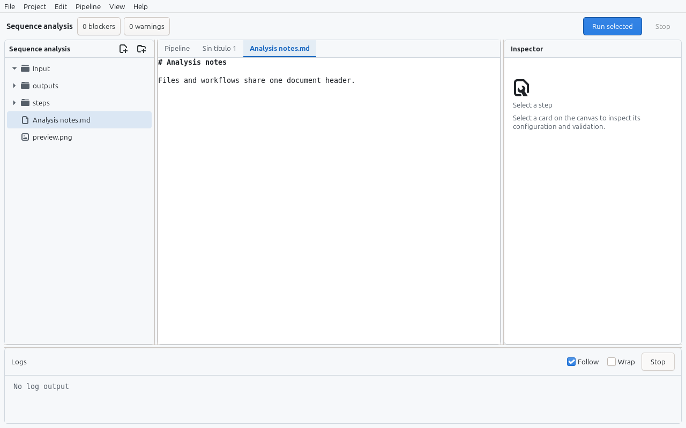
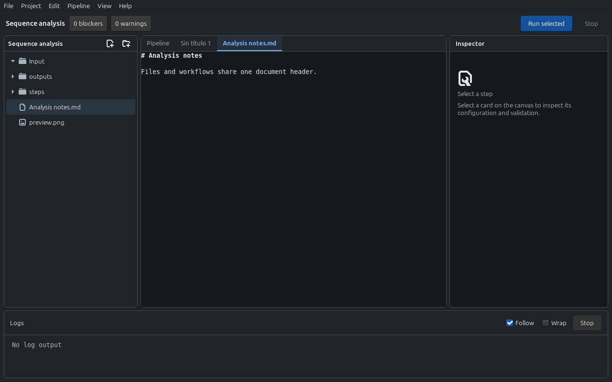
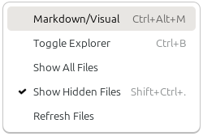
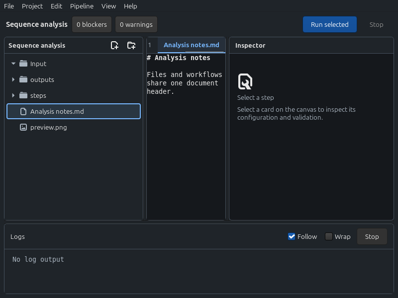
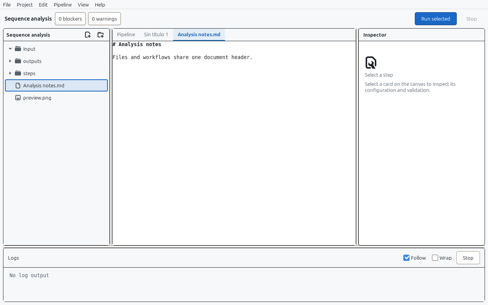
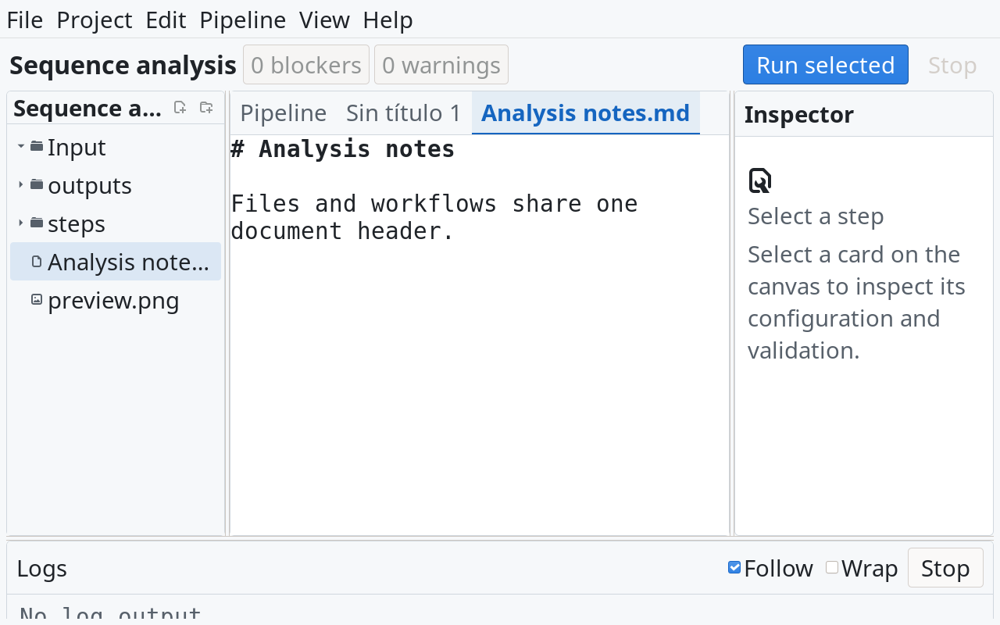

# Workspace navigation review — 2026-11-14

Native GTK4/Cairo changes on `feat/explorer-navigation`, collected under
Unreleased. No dependency, pipeline format or execution changes.

## Design and scope

- Pipeline, text and image tabs occupy the center pane header instead of a
  second row below a repeated Pipeline/Workspace label.
- Keep default window dimensions, pane widths, splitter positions, document
  font sizes and Cairo card geometry. Header navigation scrolls to reveal the
  active document; it does not enlarge neighboring panes or steal editor focus.
- The explorer uses a quiet sidebar surface, symbolic chevrons and file/folder
  icons, rounded hover/selection backgrounds and the folder name as its header.
  Native New file/New folder buttons call the existing filesystem operations.
- View owns Show All Files, Show Hidden Files and Refresh Files. Visibility
  options are native checked actions, independent per window, retained on
  refresh and disabled in windows without an explorer. Ctrl+Shift+. toggles
  hidden files; Ctrl+B keeps its existing sidebar behavior.
- Keep lazy directory loading, ignored paths, symlink restrictions, context
  operations and internal/external drag and drop. No filesystem policy changed.

## Verification

All required local checks passed: 396 core tests, 190 UI tests (11 graphical or
network tests ignored by default), release build, and 22 release-policy tests.

The explicit `explorer_navigation_review` GTK test passed in light, dark,
HighContrast and large text (`Sans 22`). It exercises native action activation
and state changes, filter independence, refresh, active-document selection,
folder expansion, file/pipeline/image switching, image closure, isolation
between windows, and disabled actions in the start page. It asserts unchanged
pane positions/window dimensions across ordinary navigation, and at normal text
size a fully visible active tab at 800×600. Long tab labels at large text sizes retain
horizontal scrolling and a full-path tooltip.

`workspace_visual_review` also passed in light and dark, including canvas
keyboard selection, check toggling, zoom, pan, node dragging, step configuration,
logs, validation and actual execution of the self-contained example. The
generated report retained its expected content.

The first narrow-window iteration exposed tab clipping beneath a permanent
scrollbar. The final header uses overlay scrolling and content coordinates to
reveal the active tab without changing pane sizes. Final screenshots were
inspected after this correction.

Visual inspection used Linux/X11 and GTK 4.14.5. Folder buttons expose their
expanded state, icon buttons have accessible names, and focus was inspected in
normal/high contrast themes. Full screen-reader and Windows/macOS desktop
verification were not performed for this change.

## Reproduce

Run from the repository root, with a desktop display and a fresh temporary
output directory. The script isolates configuration, libraries and work files.

```sh
python3 scripts/review-workspace.py --surface navigation \
  --mode light --mode dark --mode contrast --mode large \
  --output /tmp/opm-navigation-review
python3 scripts/review-workspace.py --mode light --mode dark \
  --output /tmp/opm-navigation-workspace
```

## Actual GTK captures

| Light | Dark |
| --- | --- |
|  |  |

| View menu | 800×600 |
| --- | --- |
|  |  |

| High contrast focus | Large text |
| --- | --- |
|  |  |
