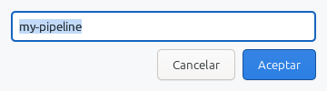
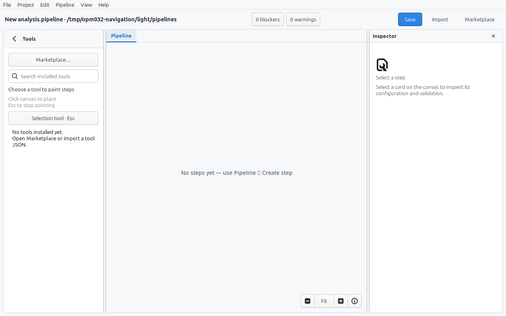
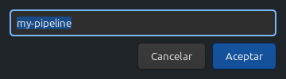
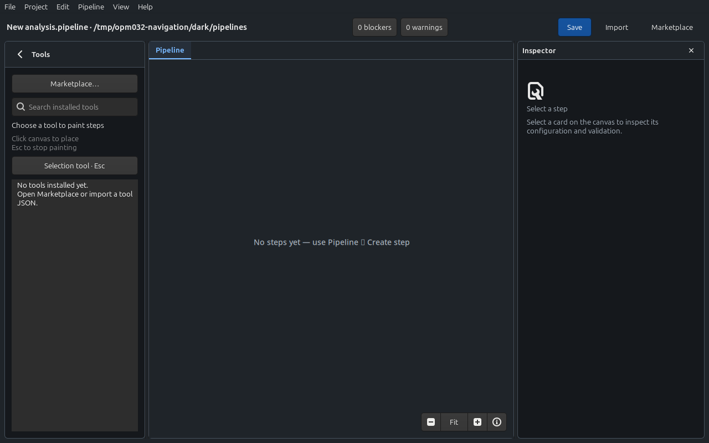

# New pipeline from Work — 0.3.2

Project → New pipeline opens the existing native name prompt from a Work
window, then creates an independent Design window. The original Work retains
its scope, open files, logs and execution. No library document is created until
Save. Cancelling the prompt opens no Design window.

The only product behavior change is action availability: New pipeline is
available in every window scope, including while Work is running. The existing
Design replacement/discard flow and the gates for structural edits, imports,
and other opening actions are retained. GTK4 and Cairo, file formats and the
execution engine are unchanged.

## Verification

The 0.3.2 source passed 397 core tests, 192 UI tests (11 ignored by default),
the release build and 22 release-policy tests. Command-gate coverage checks
New pipeline in all scopes with both idle and running state.

The explicit native `explorer_navigation_review` passed in light and dark on
Linux/X11 with GTK 4.14.5 and the Cairo renderer. It activates the registered
Work action, cancels the native prompt, opens it again, enters a name and
activates its default action. It asserts one additional Design window, the
original Work still visible with the same title and open file, byte-for-byte
unchanged `run.json`, and an empty library before Save. These GTK sessions do
not execute pipeline commands; running-state availability is checked by the
command-gate regression. They also retain the earlier navigation, pane and
800×600 checks. Windows/macOS visual interaction was not manually reviewed.

Reproduce from the repository root using a display and a fresh temporary path:

```sh
python3 scripts/review-workspace.py --surface navigation \
  --mode light --mode dark --output /tmp/opm032-navigation
```

The following are actual GTK captures from those isolated sessions. The prompt
capture excludes window-manager decorations. The empty Design window is a new,
unsaved document; the Work stays in its own window.

| Native prompt | Independent Design window |
| --- | --- |
|  |  |
|  |  |
